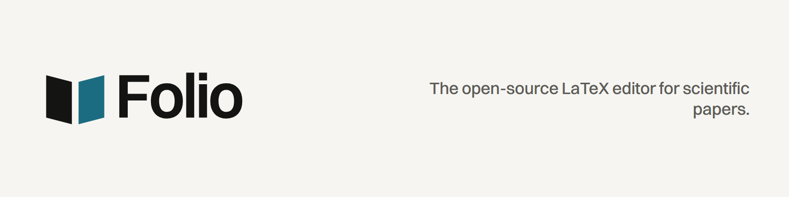
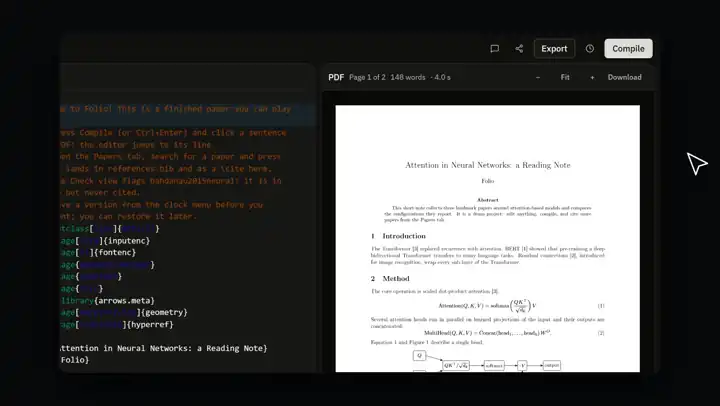
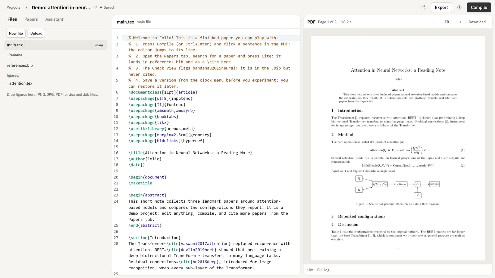
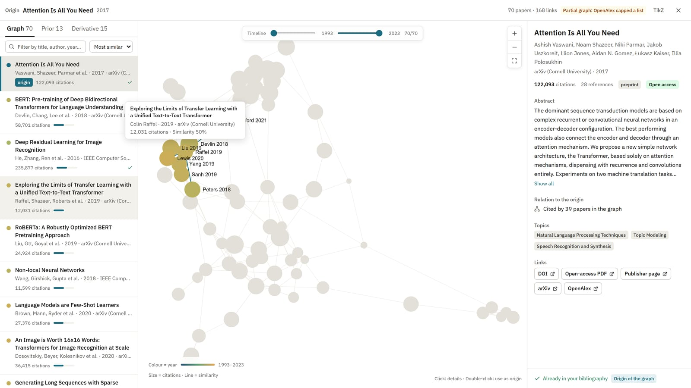
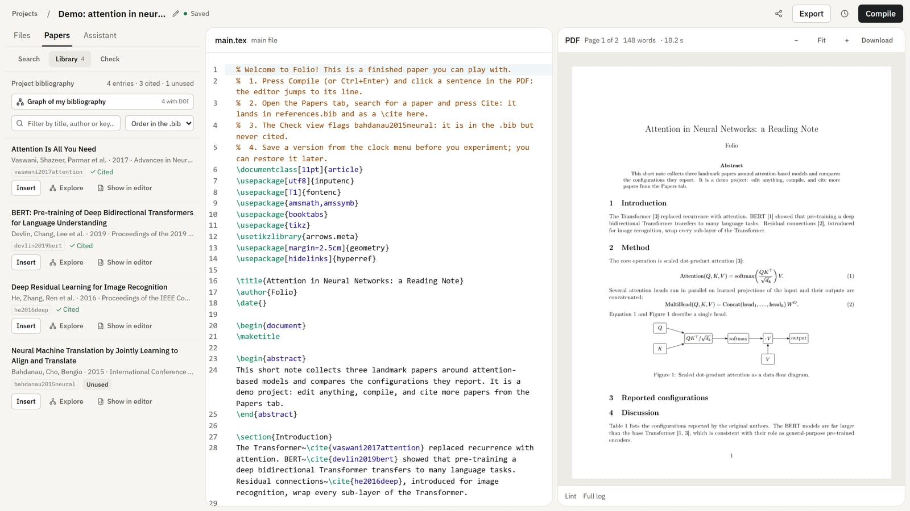
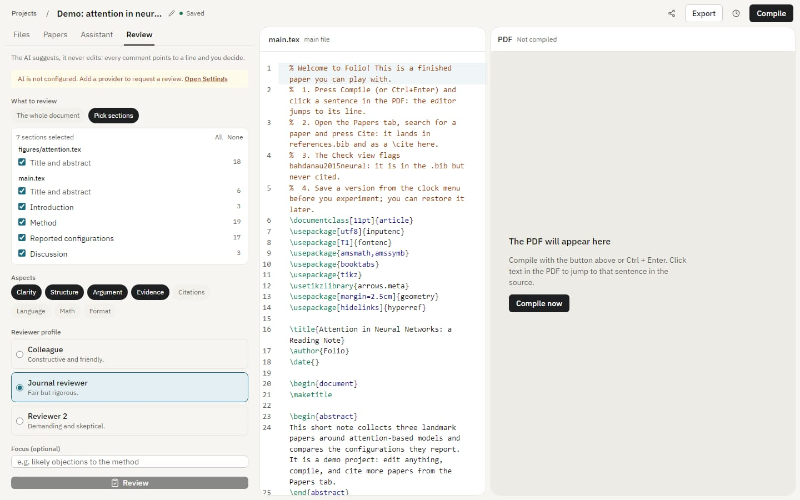

<picture>
  <source media="(prefers-color-scheme: dark)" srcset="docs/brand/banner-dark.png">
  
</picture>

<p align="center">
  <a href="https://github.com/Gjusev/folio/blob/master/LICENSE"></a>
  <a href="https://folio.mokka-agentur.de"></a>
  
  
</p>

**The LaTeX editor you can audit.** Write scientific papers with AI on your
own server: an assistant that knows your whole paper, a drafting agent that
cites only what exists, a reviewer that quotes your own lines, and every
change as a diff you apply.

<p align="center">
  <a href="https://github.com/Gjusev/folio/blob/master/public/landing/promo/film.mp4">
    
  </a>
  <br />
  <a href="https://github.com/Gjusev/folio/blob/master/public/landing/promo/film.mp4">▶ Watch the full film (57 s, with sound)</a>
</p>

**Write scientific papers with AI you can audit, on your own server.** Folio is
the open alternative to OpenAI's Prism: an assistant that knows your whole
paper, a drafting agent that brings real literature as evidence, a reviewer
that quotes your own text, compile errors fixed as patches, whiteboard photos
turned into LaTeX — with co-authors in the same project. LaTeX is the format;
the product is the writing loop, from the first literature search to the arXiv
package.

What a closed, free-for-now service cannot promise:

- **Your model.** Any OpenAI-compatible API or Anthropic's, each user with
  their own key — or local models (Ollama, vLLM), so nothing leaves the server.
  The project owner decides whether a manuscript may be sent to AI at all, and
  that rule binds every collaborator.
- **AI you can check.** Every change arrives as a diff you apply. Cite keys come
  only from your `.bib` or from literature actually retrieved; drafts are
  verified by a real compile; reviews keep a location only if the quote is
  really there. AI use is recorded, so Folio can write the declaration journals
  ask for.
- **Your data, with no end date.** Apache-2.0, your own Postgres, ZIP export at
  any time.

How Folio compares with Prism and Overleaf, and what comes next:
[Folio, the open alternative to Prism](docs/prism-alternative.md). Let your own
agent (Claude Code, Codex) work on a project through [Folio's MCP server](docs/mcp.md)
with a scoped personal token.

|                           Editor + compiled PDF                           |                                  Literature explorer                                   |
| :-----------------------------------------------------------------------: | :------------------------------------------------------------------------------------: |
|  |  |
|                            **Project library**                            |                                   **AI review mode**                                   |
|          |        |

## Coming from Prism? Migrate in two steps

Prism closes on **1 January 2027** and deletes its data. Your work does not have
to go with it:

1. In Prism: **Settings → Data Controls → Export all** (a ZIP with your sources).
2. In Folio: create an account and use **Import ZIP**. The importer takes the
   Prism export as-is (an end-to-end test checks it against a fixture of the
   format), finds the main file and drops build artefacts. It also accepts
   Overleaf projects and arXiv sources.

From then on your documents are in your Postgres, exportable as ZIP at any time.

The step-by-step version, including what does and does not survive the move,
is in [docs/moving-from-prism.md](docs/moving-from-prism.md).

## Try it in a minute

There is a public demo instance at **[folio.mokka-agentur.de](https://folio.mokka-agentur.de)**
(temporary hosting; the legal notes are [here](https://folio.mokka-agentur.de/impressum)). Every
new account can start with a **demo project**: a short, finished paper
(equations, a TikZ figure, a table, real citations) that compiles out of the
box, in English, Spanish or German. Click a sentence in the PDF, cite a paper,
save a version, ask for a review.

## Features

**Write and compile**

- LaTeX editor (CodeMirror 6) with autosave and optimistic concurrency: if two
  tabs edit the same file, Folio asks which version to keep and never
  overwrites silently.
- Autocompletion for `\cite{}`, `\ref{}`, `\eqref{}` and `\autoref{}` from your
  real `.bib` keys and `\label{}`s.
- Compilation with `latexmk` + BibTeX/biber in an isolated service with no
  internet access. Continuous PDF with zoom, errors that jump to their line,
  `chktex` lint and `texcount` word counts.
- **Exact PDF ↔ source**: click any sentence in the PDF and the editor jumps to
  its line (SyncTeX), and from an error to its page.
- Templates: article, IEEE, Elsevier (elsarticle), REVTeX, AMS, thesis with
  chapters, beamer and a response-to-reviewers letter.
- Figures: drag PNG/JPG/PDF into the file list; content is checked against the
  format before it is stored.
- Export to PDF and to a ZIP of all sources.

**Cite and explore the literature**

- Unified search across free, key-less sources (OpenAlex, Semantic Scholar,
  arXiv): one box, the source is a filter, results merged and deduplicated by
  DOI. Search by text, DOI or arXiv id; sort by relevance, citations or date;
  add the citation to your `.bib` with one click.
- **Literature explorer** in the style of Connected Papers: a _similarity_
  graph (bibliographic coupling + co-citation + direct citation), not a star of
  citations. Click a node for its full card, double-click to explore from it
  (with history), prior/derivative work lists, a year timeline and labelled
  islands for your own bibliography. Export the graph to TikZ.
- Project library: every `.bib` entry with cited/unused status, filtering and a
  jump to its line.
- Citation health and submission check: undefined keys, unused entries,
  arXiv-preprint → published-version upgrades (conservatively verified),
  forgotten `\todo`s, broken figures, abstract/keywords and word count.
- Recommendations from your bibliography (Semantic Scholar, OpenAlex neighbours
  as fallback; the engine is always shown). Zotero library sync.

**AI, on your terms (optional)**

- **Review mode**: an AI critique with filters you choose — scope (the whole
  document or individual sections), aspects (clarity, structure, argument,
  evidence, citations, language, math, format), the reviewer's profile
  (colleague, journal reviewer, "Reviewer 2") and an optional focus. Every
  comment points to a real line; locations and quotations the server cannot
  verify against the text it sent are dropped. Filter by severity and aspect,
  dismiss, copy the report as Markdown.
- **Drafting agent**: describe a section, Folio retrieves real literature as
  evidence and streams the LaTeX. Citations are structurally limited to keys in
  your `.bib` or the retrieved evidence — invented keys are removed on the
  server. It can plan the paper section by section, draft each with a word
  budget, critique the draft and verify its citations against a real compile.
- Assistant chat with your document (improve, explain, continue, fix the
  compile error), optionally grounded in your own project via RAG.
- Any provider: presets for OpenRouter (privacy on by default), OpenAI,
  Anthropic (native Messages API), Gemini, Mistral, DeepSeek, xAI, Ollama, vLLM
  or any OpenAI-compatible endpoint. Keys are per user and sealed at rest
  (AES-256-GCM); route cheap models to search and strong ones to drafting.

**Work together, keep history**

- Versions (snapshots) with labels, a visual **latexdiff** PDF between any two
  versions, and restore with automatic undo.
- Share with roles: invite co-authors as editors or viewers (viewers compile and
  export, never write).
- Real-time collaboration (experimental, opt-in): concurrent editing with remote
  cursors over Yjs; Ctrl+Z only undoes your own changes.
- Inline comments anchored to a source selection: threaded discussions across
  all project files with replies and resolve/reopen; the anchor relocates when
  the surrounding text is edited.

**Yours to run**

- Interface in English, Spanish and German, picked from the browser and
  switchable at any time.
- Installable as an app (PWA), no Electron.
- Self-hosted, Apache-2.0, with a sandboxed compiler that never runs in the web
  process.

### What Folio does not do (yet)

DOCX export; autocompletion aware of the whole document's context (today: cite
keys and labels); SSO/OIDC (local accounts only); multi-instance web deployments
(rate limits live in memory). Real-time collaboration is experimental. The AI
features are tested against fake OpenAI-compatible servers in CI, not against
paid models. See the [roadmap](docs/roadmap.md).

## Quick start (Docker)

You need Docker. No TeX installation is required.

**From published images** (no clone needed). The images are published with each
release — until the first release is out, use the from-source commands below. `FOLIO_VERSION` pins
a release and is documented in the header of the compose file.

```bash
mkdir folio && cd folio
curl -fLO https://raw.githubusercontent.com/Gjusev/folio/master/docker-compose.release.yml
```

Create a `.env` next to it with four secrets — generate each value with the
one-liner below:

```
POSTGRES_PASSWORD=<random>
COMPILER_TOKEN=<random>
COLLAB_SECRET=<random>
LLM_CREDENTIALS_KEY=<random>
```

```bash
node -e "console.log(require('crypto').randomBytes(32).toString('hex'))"

docker compose -f docker-compose.release.yml up -d
# → http://127.0.0.1:3000   (migrations run on start-up)
```

**From source:**

```bash
git clone https://github.com/Gjusev/folio.git && cd folio
cp .env.example .env
# Fill COMPILER_TOKEN, POSTGRES_PASSWORD and LLM_CREDENTIALS_KEY with random values:
node -e "console.log(require('crypto').randomBytes(32).toString('hex'))"

docker compose --profile app up -d --build
# → http://127.0.0.1:3000   (migrations run on start-up)
```

Open the app, create an account and keep "Start with the demo project" ticked.
Literature search works without any key.

Put a TLS reverse proxy (Caddy, nginx, Traefik) in front of port 3000 for
anything beyond your own machine. Production deployments, Dokploy, live
collaboration behind `wss://` and every environment variable are covered in
[docs/deployment.md](docs/deployment.md).

## Development

Requirements: Node.js ≥ 24 and pnpm (`corepack enable`), Docker.

```bash
pnpm install
cp .env.example .env          # set COMPILER_TOKEN (see above)
pnpm services:up              # Postgres + LaTeX compiler (first build takes a few minutes)
pnpm db:migrate
pnpm dev                      # http://localhost:3000
```

### Turning on AI

Add a provider in **Settings** (per user), or set a server-wide endpoint in
`.env`:

```bash
# Local and free, with Ollama in Docker:
docker compose --profile ollama up -d ollama
docker compose exec ollama ollama pull qwen3:4b
LLM_BASE_URL=http://127.0.0.1:11434/v1
LLM_MODEL=qwen3:4b

# Or a hosted provider:
LLM_BASE_URL=https://api.mistral.ai/v1
LLM_API_KEY=...
LLM_MODEL=mistral-small-latest
```

Without any provider the rest of Folio works the same and the AI panels explain
how to enable them. On a shared instance set `LLM_ENV_SHARED=false` so nobody
uses the server's key and everyone brings their own. Details:
[docs/ai.md](docs/ai.md).

## Quality

```bash
pnpm format:check && pnpm lint && pnpm typecheck
pnpm test        # unit + integration against real Postgres (needs pnpm services:up)
pnpm e2e         # real browser flows against a running stack (E2E_BASE_URL)

# Compiler isolation and template/demo compilation against the real container:
COMPILER_E2E_URL=http://127.0.0.1:3001 COMPILER_TOKEN=<token> pnpm vitest run services/latex-compiler
```

CI (`.github/workflows/ci.yml`) runs all of the above, including the compiler's
isolation tests.

## Documentation

| Document                                                 | What is in it                                                                                                            |
| -------------------------------------------------------- | ------------------------------------------------------------------------------------------------------------------------ |
| [docs/architecture.md](docs/architecture.md)             | Components, stack, data model, design decisions, the compiler sandbox                                                    |
| [docs/deployment.md](docs/deployment.md)                 | Docker Compose, reverse proxy, Dokploy, environment reference, operations                                                |
| [docker-compose.release.yml](docker-compose.release.yml) | Prebuilt-image stack for self-hosting; pin a release with `FOLIO_VERSION` (see [docs/deployment.md](docs/deployment.md)) |
| [docs/ai.md](docs/ai.md)                                 | Providers, BYOK, assistant, drafting agent, review mode, RAG, invariants                                                 |
| [docs/roadmap.md](docs/roadmap.md)                       | What shipped, what is next, known limits                                                                                 |
| [docs/brand-guidelines.md](docs/brand-guidelines.md)     | Logo, colour, type, voice and the asset pipeline                                                                         |
| [SECURITY.md](SECURITY.md)                               | Threat model and how to report a vulnerability                                                                           |
| [CONTRIBUTING.md](CONTRIBUTING.md)                       | Workflow and the rules every change follows                                                                              |
| [CHANGELOG.md](CHANGELOG.md)                             | Release notes                                                                                                            |

## Project layout

```
src/app/                   pages and API (Next.js route handlers)
src/lib/                   domain: auth, projects, importer, similarity graph, AI, review, RAG, i18n
src/components/            UI (workspace, graph explorer, papers tab, landing)
services/latex-compiler/   the isolated compile service (no dependencies)
services/collab/           WebSocket relay for live collaboration (opt-in)
drizzle/                   versioned SQL migrations
scripts/                   migrations, password reset, brand and screenshot generators
test/e2e/                  Playwright specs against a running stack
docs/                      documentation, brand assets and images
```

## License and credits

[Apache-2.0](LICENSE). TeX Live is installed in the compiler image from Debian
packages and is not redistributed in this repository.

The public demo at [folio.mokka-agentur.de](https://folio.mokka-agentur.de) is
operated by Mokka Agentur; its [Impressum](https://folio.mokka-agentur.de/impressum)
and [privacy notice](https://folio.mokka-agentur.de/datenschutz) describe what
that instance processes. Your own instance answers to nobody but you. The continuous PDF viewer
pattern is adapted from [assistant-ui/open-prism](https://github.com/assistant-ui/open-prism)
(MIT). The Switzer typeface is by the Indian Type Foundry, used under the
[ITF Free Font License](https://www.fontshare.com/licenses/itf-ffl).
