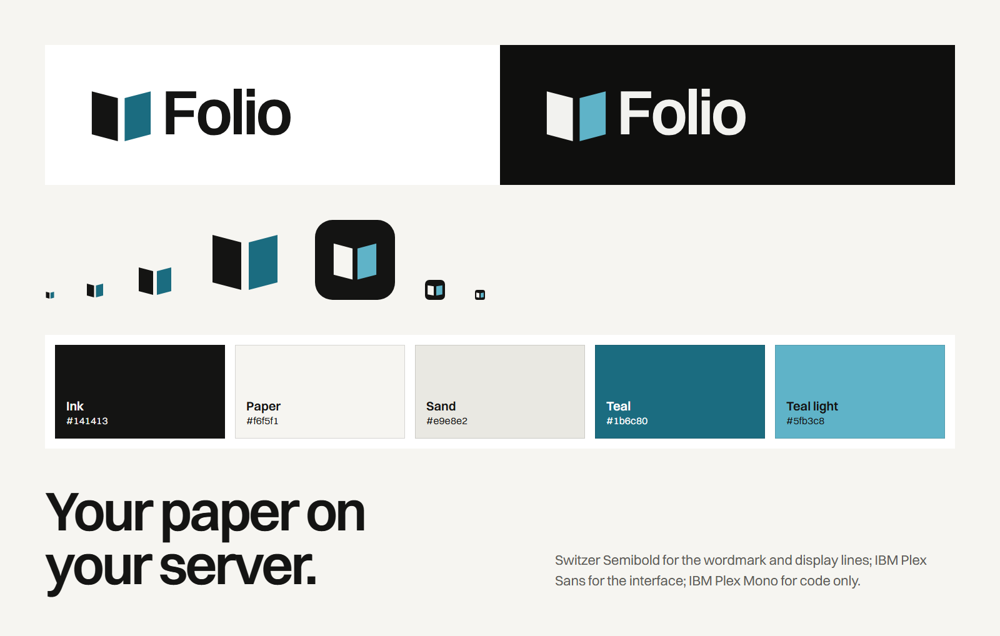

# Brand guidelines

> Version 1.0 · November 2026 · Source of truth for code: [`src/lib/brand.ts`](../src/lib/brand.ts)



## Quick reference

| Element    | Value                                                                  |
| ---------- | ---------------------------------------------------------------------- |
| Name       | **Folio** (always capital F, never "FOLIO" or "folio" in running text) |
| Promise    | Write scientific papers with AI you can audit, on your own server.     |
| Short line | Your paper on your server.                                             |
| Descriptor | The open workspace for writing scientific papers with AI.              |
| Colours    | Ink `#141413` · Paper `#f6f5f1` · Teal `#1b6c80`                       |
| Typefaces  | Switzer (brand) · IBM Plex Sans (interface) · IBM Plex Mono (code)     |
| Voice      | Precise, plain, honest about limits                                    |

## 1. The idea

A **folio** is a sheet of paper folded once: two leaves, four pages. Folio keeps
your source on one leaf and the compiled result on the other — the same split
the editor shows on screen. The name, the mark and the product say the same
thing.

## 2. Logo

### The mark

Two leaves of an open sheet with a spine between them. The left leaf is the
**source** (ink), the right leaf is the **result** (teal). The outer edges rise
so the sheet reads as open, not flat.

- Grid: 64 × 64 units. Left leaf `M6 12 L29 18 V56 L6 50 Z`, right leaf
  `M35 18 L58 12 V50 L35 56 Z`, spine 6 units.
- **Small variant** (48 px and below: favicons, tab icons): the spine widens to
  10 units and the tilt flattens (`MARK_SMALL`), so the gap survives
  antialiasing.

### The wordmark

"Folio" in **Switzer Semibold**, tracking −0.04 em, converted to outlines (the
logo never depends on a font being installed).

### Lockup

The leaves' outer edge is exactly as tall as the capitals and starts at the cap
line; the spine dips just below the baseline, the way an open sheet would. The
gap between mark and "F" is fixed by the geometry in `src/lib/brand.ts` — never
re-space it by hand.

### Files

| Asset                      | File                                               | Use                                                       |
| -------------------------- | -------------------------------------------------- | --------------------------------------------------------- |
| Logo, light grounds        | `public/brand/logo.svg`                            | Documents, README, light UI                               |
| Logo, dark grounds         | `public/brand/logo-dark.svg`                       | Dark UI, slides                                           |
| Logo, one colour           | `public/brand/logo-mono.svg`                       | Print, embossing, single-colour contexts (`currentColor`) |
| Mark (light / dark / mono) | `public/brand/mark*.svg`                           | Avatars, small spaces                                     |
| App icon                   | `public/icon.svg`, `icon-192.png`, `icon-512.png`  | Browser and PWA                                           |
| Maskable icon              | `public/icon-maskable-512.png`                     | Android adaptive icons                                    |
| Small icon                 | `public/icon-small.svg`, `src/app/favicon.ico`     | Favicon (16/32/48)                                        |
| Apple touch icon           | `src/app/apple-icon.png`                           | iOS home screen                                           |
| Social card                | `src/app/opengraph-image.png`, `twitter-image.png` | Link previews (1200 × 630)                                |
| GitHub social preview      | `docs/brand/social-preview.png`                    | Repository settings → Social preview (1280 × 640)         |
| README banner              | `docs/brand/banner-light.png`, `banner-dark.png`   | Top of the README                                         |

In the app, use the `<Logo>` and `<Mark>` components (`src/components/Logo.tsx`):
they draw the brand inline, the source leaf and wordmark in `currentColor` and
the result leaf in the theme's accent, so they follow light and dark mode.

### Clear space and minimum size

- Clear space around the logo: at least the width of one leaf on every side.
- Minimum size: logo 96 px wide on screen (25 mm in print); mark 16 px (use the
  small variant below 48 px).

### Don't

- Don't recolour the leaves outside the palette, swap their order or make both
  leaves the same colour (except the one-colour version).
- Don't rotate, skew, outline or add shadows, glows or gradients.
- Don't typeset "Folio" in another face next to the mark; use the outlined
  wordmark.
- Don't add a full stop or other punctuation to the wordmark.
- Don't place the logo on busy photographs; use a flat field from the palette.

## 3. Colour

| Name       | Hex       | Role                                                 |
| ---------- | --------- | ---------------------------------------------------- |
| Ink        | `#141413` | Text, the source leaf, solid buttons                 |
| Paper      | `#f6f5f1` | Ground: a warm stone, not cream                      |
| Sheet      | `#ffffff` | Surfaces: the compiled page, panels                  |
| Sand       | `#e9e8e2` | The one tone step between surfaces                   |
| Stone      | `#5d5c58` | Secondary text                                       |
| Teal       | `#1b6c80` | The accent: the result leaf, links, selection, focus |
| Teal light | `#5fb3c8` | The accent on dark grounds                           |
| Night      | `#0f0f0e` | Dark ground                                          |
| Night ink  | `#f2f2ef` | Text on dark ground                                  |

**Proportions.** One ground, one ink, one accent. The accent is for the action
and data, not decoration; most screens show it once or twice.

**Contrast (WCAG 2.1, measured).**

| Pair                | Ratio  | Passes    |
| ------------------- | ------ | --------- |
| Ink on Paper        | 16.9:1 | AAA       |
| Ink on Sheet        | 18.4:1 | AAA       |
| Stone on Paper      | 6.1:1  | AA (body) |
| Stone on Sand       | 5.5:1  | AA (body) |
| Teal on Paper       | 5.5:1  | AA (body) |
| White on Teal       | 6.0:1  | AA (body) |
| Teal light on Night | 8.0:1  | AAA       |
| Night ink on Night  | 17.1:1 | AAA       |

Semantic colours (success `#1e7b4f`, error `#c4242a`, warning `#92400e`) are for
states only and never appear in the brand.

## 4. Typography

| Role              | Face          | Weights  | Notes                                              |
| ----------------- | ------------- | -------- | -------------------------------------------------- |
| Wordmark, display | Switzer       | 600      | Tracking −0.04 em, leading 0.95–1.0, sentence case |
| Marketing text    | Switzer       | 400, 500 | 17–19 px body, leading 1.5                         |
| Interface         | IBM Plex Sans | 400–600  | The app                                            |
| Code              | IBM Plex Mono | 400      | LaTeX source and logs only — never as decoration   |

Switzer is self-hosted (`public/fonts/`, ITF Free Font License); IBM Plex comes
from `@fontsource`. No font is loaded from a CDN (the app's CSP forbids it).

Headlines stay on two lines or fewer at every width. No small uppercase labels
above headings, no monospace eyebrows, no index numbers like 01/02/03.

## 5. Voice

Folio talks like a careful colleague who has read your paper.

| We are                                         | We are not                                              |
| ---------------------------------------------- | ------------------------------------------------------- |
| Precise: numbers, names, what happens          | Vague: "powerful", "seamless"                           |
| Plain: short sentences, real verbs             | Jargon-heavy or cute                                    |
| Honest: we state limits                        | Overselling: no invented metrics, testimonials or logos |
| Calm in errors: what went wrong and what to do | Blaming or alarming                                     |

**Messaging pillars**

1. **AI you can audit** — the AI drafts, rewrites, fixes and reviews, and
   every step is checkable: changes arrive as diffs the author applies, cite
   keys come only from the `.bib` or retrieved literature, drafts are verified
   by a real compile, and AI use is recorded for the journal's disclosure. Say
   what the AI does; never "AI-powered".
2. **Yours** — self-hosted, Apache-2.0, your Postgres, export at any time; any
   model including local ones, each user's own key, and the owner decides
   whether a manuscript may leave the server.
3. **Correct** — compiles in an isolated sandbox; locations and quotes checked
   before they are shown.
4. **Literate** — real literature search and a citation graph built into the
   editor.

Positioning: Folio is the open alternative to OpenAI's Prism — LaTeX is the
format, the product is the writing loop. See
[`prism-alternative.md`](prism-alternative.md).

**Words we avoid:** revolutionary, seamless, effortless, magic, best-in-class,
leverage, AI-powered (say what the AI does instead).

**Examples**

- Marketing: "Your paper on your server."
- Docs: "Set `ALLOW_REGISTRATION=0` once your accounts exist."
- Error: "The AI did not return a valid review. Try again."
- Empty state: "Start with the demo project, a template, or the Prism or
  Overleaf ZIP."

## 6. Imagery

1. **The product itself**: real screenshots of the app with real content (the
   demo project), never mock dashboards. Regenerate them with
   `node scripts/landing-shots.mjs`.
2. **The world of the subject**: printing, paper, manuscripts — archival
   pictures from open collections (CC0 or CC BY/BY-SA), always credited.
3. Square corners or a small radius, flat fields of colour, no gradients, no
   drop shadows, no stock photos of people at laptops.

## 7. Asset pipeline

Every raster asset is generated from `src/lib/brand.ts`:

```bash
node scripts/brand-assets.mts
```

It writes the SVG logos, the app icons and favicon, the Open Graph/Twitter
image, the GitHub social preview, the README banners and the overview sheet at
the top of this page. Change the brand in `src/lib/brand.ts`, run the script,
commit the results.

The GitHub social preview is not set by files in the repository: upload
`docs/brand/social-preview.png` in **Settings → General → Social preview**.
